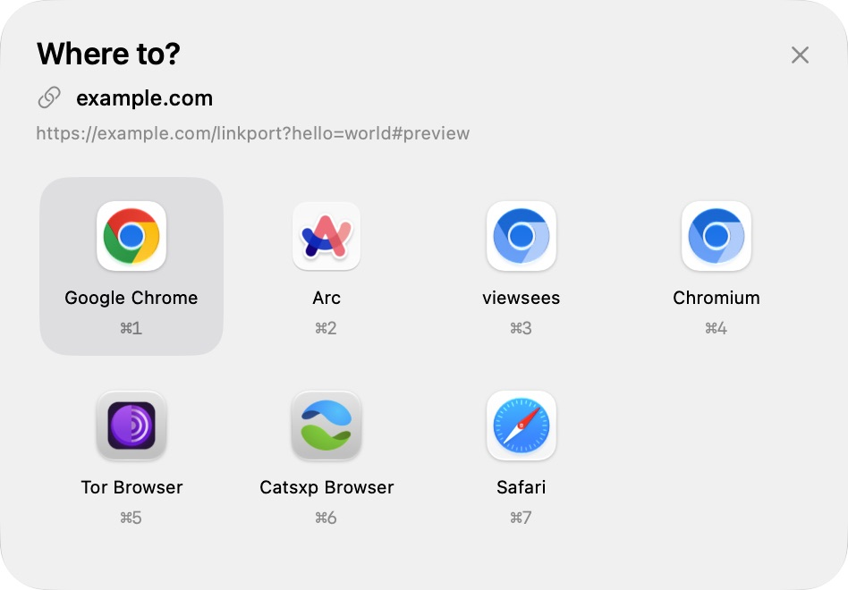
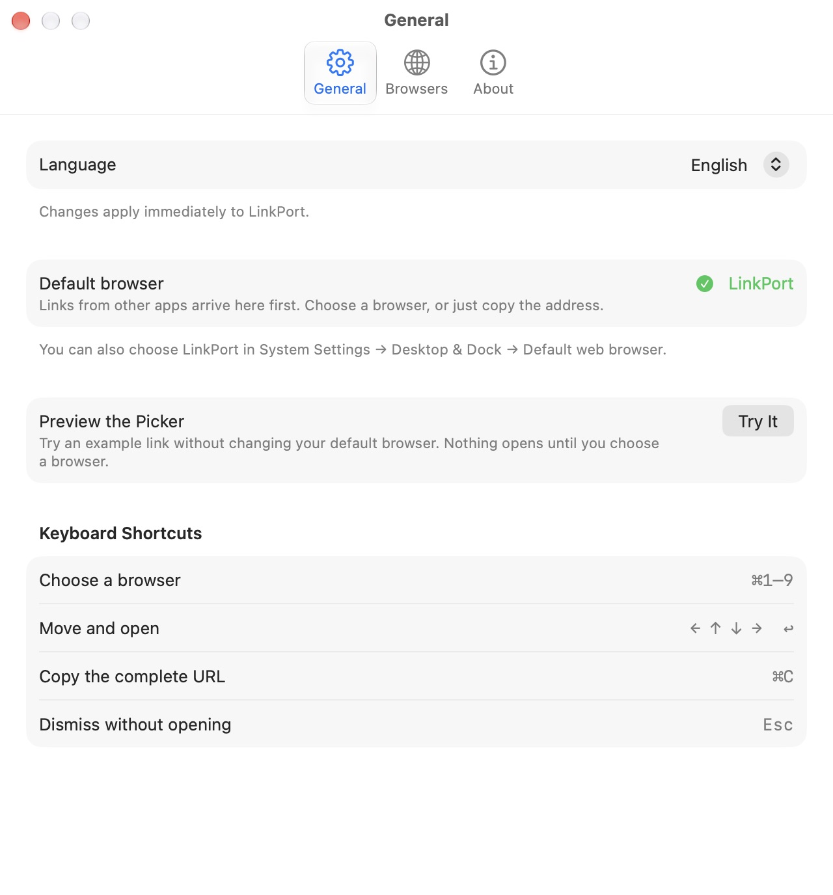

# LinkPort

[](https://github.com/qianmokano/LinkPort/actions/workflows/ci.yml)

**A choice for every link.** A native macOS menu bar utility that lets you choose a browser when another app opens a website—or copy the URL instead.

[简体中文](README.zh-CN.md) · [Contributing](CONTRIBUTING.md) · [Development](docs/development.md) · [MIT license](LICENSE)



## Features

- Choose from installed browsers in a compact picker near the pointer.
- Open HTTP/HTTPS links and local HTML/XHTML files passed to the system default browser.
- Copy the complete URL with `⌘C`, preserving encoding, query parameters, and fragments.
- Reorder or hide browsers; handle multiple links one at a time.
- Navigate with the keyboard, use multiple displays, and follow the system's appearance.
- Switch between English, Simplified Chinese, and the system language immediately.
- Keep preferences on your Mac, with no accounts, analytics, or browsing history.

LinkPort uses SwiftUI and AppKit and has no third-party runtime dependencies.

## Requirements and availability

| | Requirement |
| --- | --- |
| Run | macOS 26 or later; Apple Silicon or Intel |
| Build | Xcode 27 or later with the macOS 27 SDK and Swift 6.4 or later |
| Full checks | The build tools above and Python 3.9 or later (standard library only) |

**Version 1.0.0 is not released yet.** Build from source for now. The build script creates an **ad-hoc signed app**, without Developer ID signing or Apple notarization. The [release guide](docs/releasing.md) describes this community distribution path and the separate Developer ID/notarization path.

Apple Silicon on macOS 27 has been exercised locally. Intel has been cross-compiled and launched under Rosetta; Intel hardware and macOS 26 still need device testing. See [testing and compatibility](docs/testing.md).

## Build and install

Download or check out the source, open a terminal in the project directory, and run:

```sh
./scripts/build-app.sh
```

The output is `dist/LinkPort.app`, `dist/LinkPort.zip`, and `dist/SHA256SUMS`. Drag the app into `/Applications` or `~/Applications`, then launch that installed copy. Double-clicking LinkPort opens Settings.

The scripts use an installed `/Applications/Xcode.app` when Command Line Tools is selected. For another Xcode location, set `DEVELOPER_DIR` to that app's `Contents/Developer` directory. The global developer-tool selection is left alone.

In **Settings → General**, click **Set as Default Browser** and accept macOS's confirmation. You can also choose LinkPort in **System Settings → Desktop & Dock → Default web browser**. Both HTTP and HTTPS must point to LinkPort. A complete `.app` bundle is required; `swift run` is not an installation method.

To try the picker first, click **Try It** in General settings. The preview uses an example URL and opens nothing until you select a browser.

### If macOS blocks the app (Gatekeeper)

The current package has an ad-hoc signature, without Developer ID signing or Apple notarization. After downloading it, macOS may report that the developer cannot be verified or that Apple cannot check the app for malicious software.

Continue only if you trust the download source.

1. Extract the ZIP, move `LinkPort.app` into Applications, and try opening it once.
2. If macOS blocks it, dismiss the alert, then go to **System Settings → Privacy & Security**.
3. Scroll to **Security**, find the message about LinkPort, and click **Open Anyway**.
4. Review the next confirmation and click **Open** if you want to proceed. macOS saves an exception for the app.

On a managed Mac, this option may be restricted by your administrator. If the alert says the app is damaged or will damage your computer, stop and re-download or contact the maintainer rather than treating it as an unidentified-developer alert. See [Apple's instructions](https://support.apple.com/en-us/102445).

#### Terminal alternative

For a copy you trust, you can also remove the download quarantine attribute in Terminal, then open the app again:

```sh
xattr -dr com.apple.quarantine "/Applications/LinkPort.app"
```

Replace the path if you installed LinkPort elsewhere. This recursively removes the quarantine attribute from that app and its contents; it does not re-sign or notarize the app. Keep the attribute in place while testing the Gatekeeper instructions above.

## Using LinkPort

Click a link in another app, then choose a browser. LinkPort can only handle links the app sends through the system default browser; embedded web views and links explicitly directed to a particular browser remain with that app.

| Shortcut | Action |
| --- | --- |
| `⌘1`–`⌘9` | Open in one of the first nine visible browsers |
| `←` `↑` `↓` `→`, then `Return` | Select a browser and open |
| `⌘C` | Copy the complete URL to the system clipboard |
| `Esc` or click outside | Cancel all pending links |

Multiple links are queued in order. Duplicate URLs still in the queue are merged. Opening or copying advances to the next link; cancelling clears the queue.

Open **Settings** from the menu bar to change browser order and visibility. Enabled browsers stay first. Drag or use the arrow buttons within each group; hold a dragged row near the list's top or bottom edge to scroll. Enabling a browser moves it to the end of the enabled group; disabling it moves it to the start of the hidden group. Newly discovered browsers are appended to the enabled group.

LinkPort stays in the menu bar when Settings closes. After quitting, macOS can launch it again to handle the next link. Login launch is not configured automatically.

<details>
<summary>General settings</summary>



</details>

Screenshots show the actual app on macOS 27 using an example URL. Browser availability and appearance vary by Mac.

## Privacy and scope

LinkPort itself makes no network requests and stores no URL history. Pending URLs live in memory until handled or cancelled. Only browser order, visibility, language, and the welcome preference are saved in UserDefaults under `com.linkport.app`. Choosing a browser passes the URL to that browser; `⌘C` puts it on the system clipboard.

Browser discovery uses macOS's registered HTTP/HTTPS handlers, so other link routers may appear too; hide them if needed. Supported local files are `.html`, `.htm`, `.xhtml`, and `.xht`. Remote file hosts, other file types, and custom URL schemes are outside the current scope. Site rules, browser profiles, sync, extensions, and automatic updates are not included.

## Restore your browser or uninstall

Choose Safari or another browser as the default in System Settings first. Then quit LinkPort and remove the app. To also reset its preferences, run the following **after quitting**:

```sh
defaults delete com.linkport.app
```

## Development and community

```sh
./scripts/test.sh    # Swift tests, with coverage
./scripts/check.sh   # All checks, including the Universal build
```

Read the [development guide](docs/development.md), [test matrix](docs/testing.md), and [contribution guide](CONTRIBUTING.md). Issues and pull requests may be written in English or Chinese. Follow the [code of conduct](CODE_OF_CONDUCT.md); security reports follow the [security policy](SECURITY.md).

Source and contributions are hosted at [qianmokano/LinkPort](https://github.com/qianmokano/LinkPort). Use [Issues](https://github.com/qianmokano/LinkPort/issues) for bugs and feature requests, [GitHub Actions](https://github.com/qianmokano/LinkPort/actions/workflows/ci.yml) for checks, and [private vulnerability reporting](https://github.com/qianmokano/LinkPort/security/advisories/new) for security issues. No release downloads are published yet.

## License

LinkPort's code, documentation, and original branch artwork are available under the [MIT License](LICENSE), copyright © 2026 qianmokano. Browser icons displayed by macOS remain the property of their respective owners.
